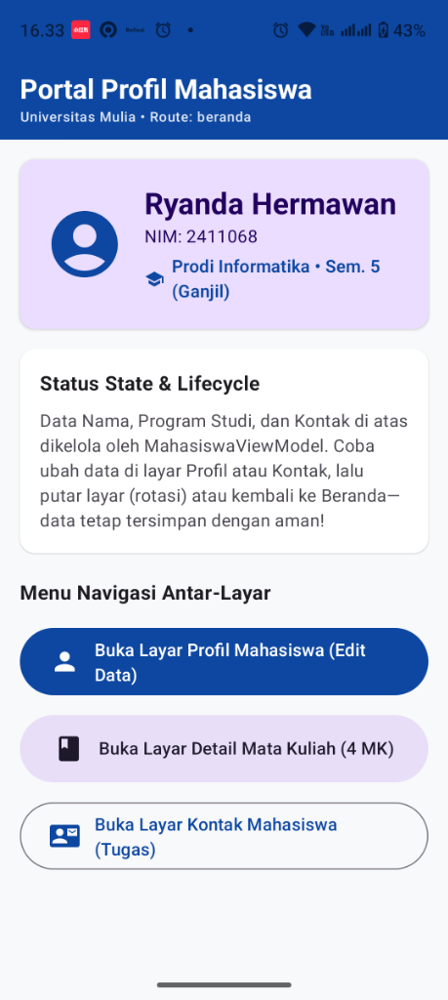
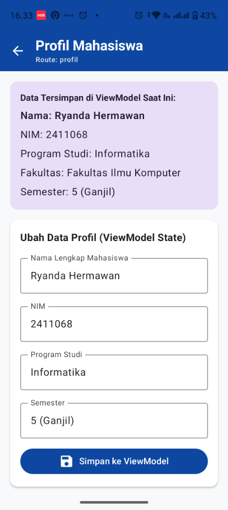
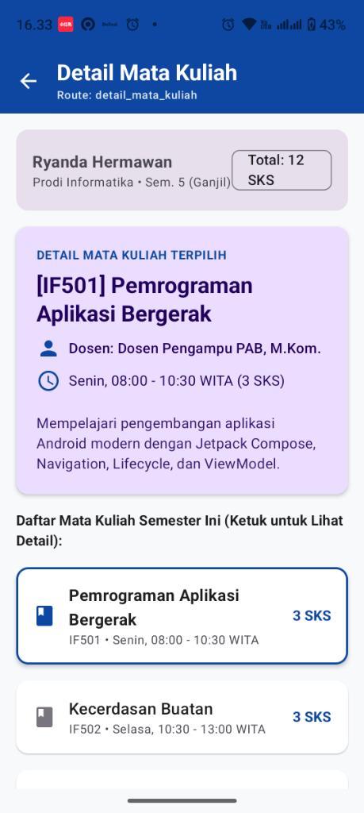
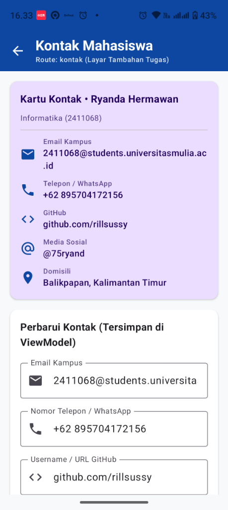

# 🎓 Aplikasi Profil Mahasiswa — Multi-Screen Flutter (Dart)

Tugas & Praktikum **Materi 5: Navigation, Lifecycle & ViewModel**  
Mata Kuliah: **Pemrograman Aplikasi Bergerak**  
Program Studi: **S1 Informatika** — **Universitas Mulia**  

**Pengembang:**
- **Nama:** Ryanda Hermawan
- **NIM:** 2411068
- **GitHub:** [@rillsussy](https://github.com/rillsussy)

---

## 📸 Tangkapan Layar Aplikasi (Screenshots Hasil Run)

| 1. Layar Beranda | 2. Layar Profil Mahasiswa |
| :---: | :---: |
|  |  |
| **3. Layar Detail Mata Kuliah** | **4. Layar Kontak Mahasiswa (Tugas)** |
|  |  |

---

## 🚀 Fitur & Alur Navigasi Antar-Layar (Flutter Navigator & Routes)

Aplikasi ini dibangun menggunakan arsitektur **Flutter** modern dengan pemisahan tanggung jawab (*separation of concerns*) berbasis **MVVM (Model-View-ViewModel)**:

| Layar | Route | Deskripsi & Interaksi |
| :--- | :--- | :--- |
| **1. Beranda** | `/` (`AppRoutes.beranda`) | Halaman utama yang menampilkan ringkasan profil mahasiswa langsung dari `MahasiswaViewModel` serta tombol navigasi menuju seluruh layar. |
| **2. Profil Mahasiswa** | `/profil` (`AppRoutes.profil`) | Menampilkan identitas akademik dan formulir interaktif (`TextField`) untuk memperbarui **Nama**, **NIM**, **Program Studi**, dan **Semester** yang langsung tersimpan ke `ViewModel`. |
| **3. Detail Mata Kuliah** | `/detail_mata_kuliah` (`AppRoutes.detailMataKuliah`) | Menampilkan rincian daftar mata kuliah yang diambil semester ini (SKS, dosen pengampu, jadwal, dan deskripsi). Pengguna dapat memilih mata kuliah untuk melihat detail interaktif. |
| **4. Kontak Mahasiswa *(Layar Tambahan Tugas)*** | `/kontak` (`AppRoutes.kontak`) | Layar tugas mandiri yang memuat identitas kontak mahasiswa (**Email Kampus**, **Nomor Telepon / WhatsApp**, **GitHub**, **Media Sosial**, dan **Domisili**) serta formulir edit kontak ke `ViewModel`. |

---

## 🛠️ Arsitektur & Teknologi

- **Bahasa**: Dart 3.13+
- **Framework**: Flutter 3.47+ (Material Design 3)
- **Navigation & Routing**: Flutter `Navigator` (`Navigator.pushNamed` & `Navigator.pop`) dengan pengelolaan riwayat tumpukan layar (*Back Stack*).
- **State Management / ViewModel**: `provider` (`ChangeNotifierProvider` & `ChangeNotifier`) sebagai implementasi *ViewModel / State Holder pattern* yang reaktif.
- **Lifecycle & State Persistence**: Data pada `MahasiswaViewModel` tetap utuh dan tersinkronisasi saat pengguna berpindah antar-halaman maupun ketika layar dirotasi (*configuration change*).
- **Testing**: Pengujian komponen widget otomatis via `test/widget_test.dart` (`All tests passed!`).

---

## ✅ Checklist Keberhasilan Praktik & Tugas (Materi 5)

- [x] Aplikasi memiliki 4 layar (3 layar utama praktikum + 1 layar tugas mandiri Kontak Mahasiswa).
- [x] Setiap layar memiliki *route* yang terdefinisi secara eksplisit (`/`, `/profil`, `/detail_mata_kuliah`, `/kontak`).
- [x] Navigasi berjalan mulus tanpa *crash* menggunakan `Navigator.pushNamed()`.
- [x] Tombol kembali bekerja sesuai riwayat tumpukan layar (*Back Stack* / `Navigator.pop()`).
- [x] `MahasiswaViewModel` (`ChangeNotifier`) digunakan sebagai *single source of truth* untuk menjaga *UI State*.
- [x] Kode di-*commit* ke GitHub dengan bahasa utama **Dart (Flutter)**.
- [x] Tersedia file APK siap pakai pada repository.

---

## 📦 Berkas Unduhan
- **File APK Siap Instal:** [`ProfilMahasiswaApp.apk`](ProfilMahasiswaApp.apk)
- **Dokumen Laporan PDF:** [`Laporan_Tugas_Profil_Mahasiswa_2411068_Ryanda_Hermawan.pdf`](Laporan_Tugas_Profil_Mahasiswa_2411068_Ryanda_Hermawan.pdf)
