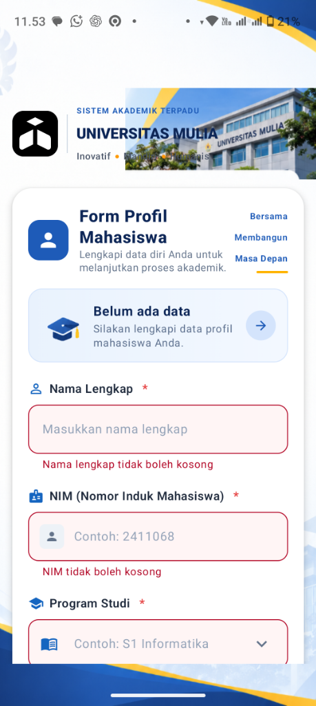
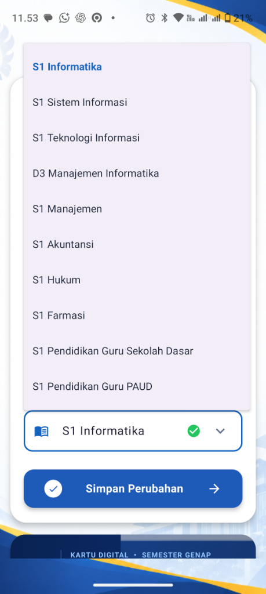

# 🎓 Profil Mahasiswa — Aplikasi Android Jetpack Compose

Aplikasi formulir profil mahasiswa dan kartu identitas digital mahasiswa berbasis **Android Jetpack Compose & Kotlin** untuk pemenuhan tugas mata kuliah **Pemrograman Aplikasi Bergerak**.

---

## 📸 Tangkapan Layar Aplikasi (Screenshots)

| 1. Form & Validasi Error | 2. Pilihan Program Studi (Dropdown) | 3. Data Tersimpan & Kartu Digital |
| :---: | :---: | :---: |
|  |  |  |

---

## 🚀 Fitur Utama
1. **Input Data Mahasiswa**:
   - Nama Lengkap (hanya huruf & spasi, minimal 3 karakter).
   - NIM / Nomor Induk Mahasiswa (numeric keyboard, 7–12 digit angka).
   - Program Studi (minimal 3 karakter).
2. **Validasi Real-time & Error Handling**:
   - Pesan error interaktif muncul di bawah input ketika data tidak sesuai aturan.
   - Indikator centang hijau (valid) ketika format input sudah benar.
3. **Tombol Simpan Dinamis**:
   - Tombol *Simpan Perubahan* otomatis aktif (enabled) **hanya jika semua input valid**.
4. **Kartu Profil Digital**:
   - Kartu digital modern dengan aksen warna Universitas Mulia (merah, kuning, biru, hijau).
   - Terintegrasi reaktif dengan data yang telah disimpan.
5. **Notifikasi Snackbar**:
   - Menampilkan konfirmasi pop-up saat data profil berhasil disimpan.

---

## 🛠️ Teknologi & Arsitektur
- **Bahasa**: Kotlin 2.0
- **UI Framework**: Jetpack Compose (Material3)
- **Architecture Pattern**: MVVM (Model-View-ViewModel) menggunakan `State` & `mutableStateOf`
- **Gradle Version Catalog**: `libs.versions.toml`
- **Minimum SDK**: Android 7.0 (API level 24)
- **Target SDK**: Android 15 (API level 35)

---

## 📝 Refleksi Singkat Pengembangan

Pengembangan aplikasi **Profil Mahasiswa** dengan Jetpack Compose ini memberikan pemahaman mendalam mengenai paradigma **Declarative UI**:

1. **State-Driven UI & Reaktivitas**:
   Berbeda dengan XML imperative berbasis `findViewById`, Jetpack Compose membuat UI secara otomatis merender ulang (*recomposition*) ketika state di `ProfilViewModel` berubah. Hal ini menyederhanakan sinkronisasi antara input form, validasi tombol, dan tampilan kartu profil digital.

2. **Validasi Input yang Bersih**:
   Pemisahan aturan logika bisnis (validasi regex, panjang karakter, kondisi enabled tombol) ke dalam ViewModel menjaga komponen UI tetap bersih, modular, dan mudah diuji (*testable*). Mekanisme penanda interaksi pengguna (*touched state*) mencegah munculnya pesan error sebelum pengguna mulai mengetik.

3. **Material Design 3 & Konsistensi Visual**:
   Komposisi visual seperti gradien warna tema universitas, sudut membulat (*rounded corners*), indikator status, serta integrasi Scaffold dengan `SnackbarHost` menunjukkan fleksibilitas Compose dalam menghasilkan desain modern dan elegan tanpa boilerplate kode XML yang rumit.

---

## 👥 Pengembang
- **Mata Kuliah**: Pemrograman Aplikasi Bergerak
- **Perguruan Tinggi**: Universitas Mulia
